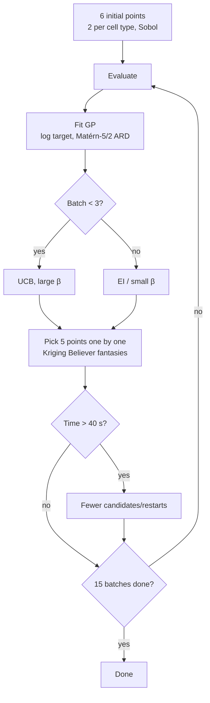

# Design: Batch BO bioprocess

## What we know about the problem (measured 24 Oct 2026)
| Finding | Consequence for the design |
|---|---|
| `measurement()` calls `np.random.seed(1234)` before every noise draw → the "noise" is a **constant factor 1.0377** (the same for every point). The objective is deterministic. | GP with almost no noise term (nugget ~1e-6), no repeat measurements needed. |
| The simulator's `np.random.seed(1234)` resets the **global** numpy RNG on every evaluation. | Never use `np.random.*` in the algorithm (it would replay the same stream after every batch); use `np.random.default_rng()` or `random` instead. |
| Values span 2 orders of magnitude (6 initial points: 1.3 … 32.6; 300 random points: best 305). | Transform the target before fitting the GP (log, or rank/standardisation). |
| ~0.08 s per evaluation → 81 evaluations ≈ 7 s. | ~35 s are left for model and acquisition. |
| Physics: temperature and pH effects are asymmetric bells around cell-type-dependent optima; the feed tops up glucose/glutamine at t = 40/80/120. | Smooth, unimodal structure per cell type → a GP with an ARD kernel fits well. |
| Marking uses different kinetics parameters. | No assumptions about where the optima are, only about structure (bounds, smoothness). |
| 300 random points per cell type: best values 130/135/331 (package); the optima move with each parameter set, and in `swapped` a different cell type wins. | Cover all cell types early, do not commit to one cell type. |
| Score = best-so-far from batch 3 on. | Batches 1–2 may explore, after that exploit quickly. |

## Approach (candidate 1, not yet measured)
1. **Encoding:** 5 continuous variables scaled to [0,1]; cell type one-hot (3 columns) or one kernel per cell type with a shared length scale (product kernel continuous × categorical).
2. **Start:** 6 points, 2 per cell type, continuous part from Sobol (spread out, no analysis of the space – allowed per FAQ 4).
3. **Model:** own GP (numpy), Matérn-5/2 with ARD, target log-transformed and standardised; hyperparameters via `scipy.optimize.minimize` (log marginal likelihood, a few restarts).
4. **Batch acquisition:** Kriging Believer or local penalisation: maximise EI/UCB 5 times in sequence, adding a fantasy observation after each point. Acquisition is maximised over a candidate set (Sobol points + perturbations around the best points) instead of by gradient optimisation.
5. **Schedule:** batches 1–2 UCB with large β (exploration, covering all cell types), from batch 3 EI or a smaller β, towards the end possibly 1 point of pure exploitation (posterior-mean maximum) per batch.
6. **Runtime guard:** measures elapsed time and reduces candidates/restarts as 40 s approaches.

## Evaluation setup
`BatchBayesianOptimization/eval/score.py` (local, not part of the submission). Runs the submission file including its own execution block, each run in a fresh process, after patching:
- `conditions_data.df` with a kinetics parameter set,
- `virtual_lab.conduct_experiment` with a call counter, bounds check and timestamps.

Score = Σ best-so-far over batches 3–15, computed from the recorded calls; batches finishing after 60 s count with the best value before them. It also checks the budget (1 + 15 calls, 6/5 points) and that `self.Y` matches the calls.

| Set | Change relative to the package |
|---|---|
| `package` | none |
| `shifted` | per cell type E_a (T optimum) −3…+4 °C, pH_opt −0.5…+0.9, my_max ×0.9…1.1 |
| `swapped` | cell types swapped (1←3, 2←1, 3←2) plus shifts as above |

Run from `BatchBayesianOptimization/`: `../.venv/bin/python eval/score.py <file> --runs 20 --jobs 8 --json eval/results/<name>.json`. Runtime is only reliable with `--jobs 1`; in parallel it is too high.

## Results
Score mean ± std over 20 runs, per parameter set (24 Oct 2026, M4, jobs=8).

| Approach | package | shifted | swapped | Max runtime | Note |
|---|---|---|---|---|---|
| Random search (`MLCE_ExampleSubmission_BO.py`) | 2000 ± 610 | 2149 ± 813 | 1842 ± 551 | 3.3 s | Baseline, grid 5⁵×3 |
| Sobol (`eval/baselines/sobol_BO.py`) | 1933 ± 716 | 1965 ± 697 | 2016 ± 693 | 7.2 s | Baseline, continuous, cell type round-robin |
| Candidate 1 | – | – | – | – | |

Upper reference: 13 × best value of 300 random points ≈ 4300 (package).

## Rejected approaches
| Approach | Result | Why rejected |
|---|---|---|
| – | – | – |
